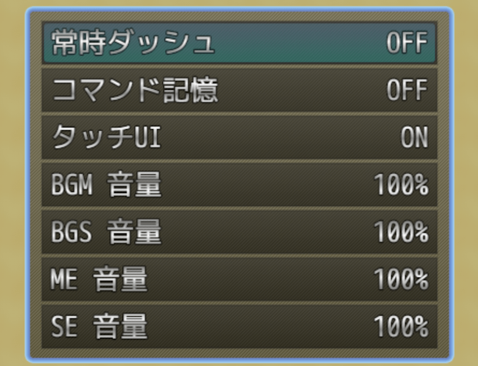
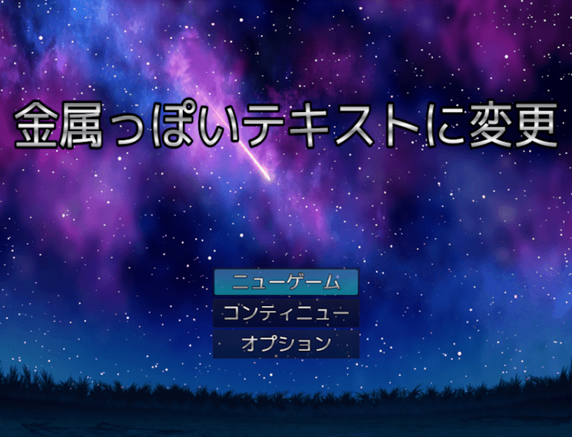
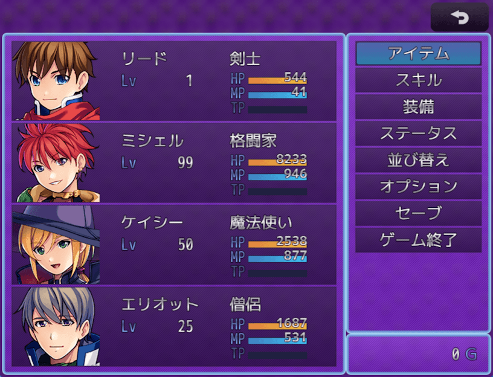

# メタリックテキスト・プラグイン（NLM_MetallicText.js）
### RPGツクールMZ用プラグイン

テキスト文字に金属調グラデーションをつけます  

UIで独自性を出したい時や、SFスチームパンク系ゲームを作る時などに使えるかも知れません  

# download

プラグインの download は、[右クリック「名前を付けてリンク先を保存」](https://raw.githubusercontent.com/nolimits-tukool/NLM_MetallicText/refs/heads/main/NLM_MetallicText.js)  
RPGツクールMZ用です

Windows11の[「スマートアプリコントロール」でブロックされる場合](https://github.com/nolimits-tukool/HandlingSmartAppControl)

# license

　MITライセンスの通りです

## [リポジトリ 一覧へ](https://github.com/nolimits-tukool?tab=repositories)
